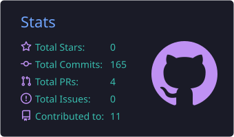
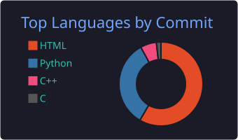

# 🧑‍💻 Eu sou o Igor, dev em formação.

Seja bem-vindo ao meu terminal pessoal! Sou um amante de tecnologia e estou sempre compilando novos desafios e aprendizados. Gosto de transformar linhas de código em soluções criativas, e cada projeto é uma chance de evoluir.

---

## 🖥️ Sobre mim:

- 🎓 Estudante de **Análise e Desenvolvimento de Sistemas (ADS)** no **IFRN – Campus Pau dos Ferros**.
- 🚀 Meu objetivo é me tornar um **programador profissional**.
- 💾 Estou construindo minha base em programação, sistemas operacionais e infraestrutura.
- 📶 Curto resolver problemas, entender como as coisas funcionam por baixo dos panos e aplicar isso em projetos reais.
- 🖱️ Também me interesso por design de interfaces e experiência do usuário.
- 📱 Aberto a conversas, parcerias em projetos e oportunidades de estágio.

---

## 📚 Em que estou estudando:

  

- 🐍 **Python**, a base de tudo o que estou aprendendo agora.
- 🌐 **Django**, para criar aplicações web com Python.
- 🔀 **Git** e **GitHub**, para versionar código e organizar meus projetos.

---

## 🛠️ Tech Stack:

### ⌨️ Linguagens:

  

### 🌐 Front-end e Design:

  

### ☁️ Infraestrutura e Ferramentas:

  

### 🐧 Sistemas e Terminal:

  
  

### 🤖 Inteligência Artificial:

  
  &nbsp;&nbsp;&nbsp;
  
  &nbsp;&nbsp;&nbsp;
  
  &nbsp;&nbsp;&nbsp;
  
  &nbsp;&nbsp;&nbsp;
  <picture>
    <source media="(prefers-color-scheme: dark)" srcset="https://api.iconify.design/ri/grok-ai-fill.svg?color=%23FFFFFF" />
    
  </picture>

### 💻 IDEs e Editores:

  
  
  &nbsp;&nbsp;
  <picture>
    <source media="(prefers-color-scheme: dark)" srcset="https://cdn.simpleicons.org/cursor/FFFFFF" />
    
  </picture>
  &nbsp;&nbsp;
  

---

## 📊 Estatísticas do GitHub:

  
  

  

---

  

---

## 📡 Redes Sociais:

---

## 💾 Citação:

> "As pessoas que são loucas o suficiente para pensar que podem mudar o mundo são as que o fazem."
>
> — **_Steve Jobs_ (1997)**.

---

  Obrigado por passar por aqui! Se curtiu algum projeto, deixe uma ⭐ no repositório.

